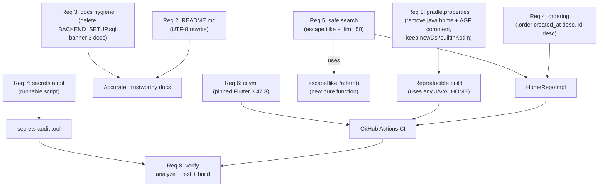

# Design Document

## Introduction

This design describes the technical approach for the **reproducible-baseline** feature of the Halbouni Book Store user app (package `adv`). It turns the approved requirements into an implementation-focused plan: which files change, how the most error-prone pieces work (Supabase ordering, ilike escaping), what the new CI and secrets-audit artifacts look like, and how the result is verified.

## Overview

The goal is a clean, reproducible baseline: the repository builds on any machine, carries accurate documentation, returns catalog lists in a stable order, handles search safely, runs CI on every push/PR, contains no analyzer warnings or committed secrets, and passes `flutter analyze` / `flutter test` / a debug APK build.

The change set is intentionally mechanical and surgical. There are **no new screens, no schema changes, no `lib/Features` renames, no application id change, no admin app changes, and no refactors beyond fixing code the analyzer flags**. The feature touches five disjoint surfaces that do not depend on each other at runtime:

1. **Build config** (`android/gradle.properties`) — remove machine-specific paths and a stale comment.
2. **Documentation** (`README.md`, `docs/*`) — rewrite the README, delete an unsafe SQL file, and banner three historical docs.
3. **Data layer** (`HomeRepoImpl` + one new pure helper) — deterministic catalog ordering, safe search escaping, and a bounded search limit.
4. **CI** (`.github/workflows/ci.yml`) — a new workflow pinned to Flutter 3.47.3.
5. **Tooling** (secrets audit script) — a reproducible scan that reports findings without exposing values or rewriting history.

Requirement 8 (clean baseline verification) is cross-cutting: it is satisfied by running `flutter analyze`, `flutter test`, and a debug build, and by keeping any analyzer fixes minimal.

**Scope guardrails (from requirements):** the admin app, the application id, the `lib/Features` names, and the live Supabase schema are explicitly out of scope. No DDL/RLS/RPC changes are made; per project rules, any schema need becomes a schema request and stops.

## Architecture

The feature does **not** change the app's runtime architecture. The existing feature-first, three-layer (data → domain → presentation) structure with Cubit + sealed states, `get_it`, `go_router`, and `Either<Failure, T>` is preserved exactly. The only production code that changes is one repository method set (`HomeRepoImpl`) plus a small pure helper; everything else is config, docs, CI, and tooling.

The diagram below shows how the requirement surfaces map to artifacts and to the cross-cutting verification step.



**Key design decisions and rationale:**

- **Extract the ilike escape into a pure, public helper.** The escape logic is the most error-prone part (order of replacement matters), and a pure function is the only piece of this feature amenable to property-based testing. Keeping it inline would make it untestable in isolation; a tiny, well-named helper is minimal and does not constitute a refactor of unrelated code.
- **Keep the existing debounce and stale-response guard untouched.** Requirements 5.3 and 5.4 are preservation constraints. The 500 ms `Timer` in `SearchViewBody` and the `_requestId` guard in `SearchCubit` already work and stay as-is.
- **Make the secrets audit a committed, runnable script.** A reproducible baseline means the audit is repeatable by anyone, not a one-person manual pass. A small Dart script (no external tools required) keeps it self-contained and cross-platform.
- **Pin CI to an exact Flutter version, not `latest`.** Requirement 6.4 forbids `latest`/`latest stable`. Pinning to `3.47.3` on the `stable` channel makes builds reproducible and matches the locally installed toolchain.

## Components and Interfaces

### 1. Build configuration — `android/gradle.properties` (Req 1)

**Responsibility:** machine-independent Gradle/Android settings.

**Change:** remove the `org.gradle.java.home=...` line (machine-specific JDK path) and the comment containing `8.7.3` (stale AGP note that no longer matches the upgraded AGP 9.1.0 toolchain). Keep `android.newDsl=false` and `android.builtInKotlin=false` (Flutter migrator opt-outs that the upgraded toolchain still relies on). All other performance flags (`jvmargs`, `daemon`, `parallel`, `caching`, `useAndroidX`, `enableJetifier`, etc.) are unchanged.

**Interface:** none. This is a properties file consumed by Gradle at build time.

**Build reliance:** with `org.gradle.java.home` removed, Gradle resolves the JDK from the environment (`JAVA_HOME`, then the `java` on `PATH`). Requirement 1.4 is satisfied by a debug build that produces an APK under a `JAVA_HOME`-configured environment.

### 2. Documentation — `README.md` and `docs/*` (Req 2, 3)

**Responsibility:** accurate, trustworthy project documentation.

**README content structure (outline — full text is an implementation task):**

- **Title + one-line description:** Halbouni Book Store, a mobile app that sells physical books and board games in Damascus with cash-on-delivery delivery inside Damascus. Currency: the new Syrian pound (SYP).
- **Tech stack:** Flutter; `flutter_bloc` (Cubit + sealed/part states); `get_it` (DI); `go_router` (routing); `supabase_flutter` (backend); `hive` (offline cart); `dartz` (`Either<Failure, T>`).
- **Prerequisites:** Flutter SDK **3.47.3** (stable channel) as the required version; a JDK 17+ available via `JAVA_HOME` (or the Android Studio bundled JBR); the Android toolchain (Gradle 9.3.1 / AGP 9.1.0 / Kotlin 2.4.0 are managed by the project).
- **Running the app:** `flutter pub get`, then
  `flutter run --dart-define=SUPABASE_URL=... --dart-define=SUPABASE_ANON_KEY=...`
- **Architecture paragraph (>= 3 sentences):** the app is feature-first; each feature under `lib/Features/` is split into `data`, `domain`, and `presentation` layers; repositories return `Either<Failure, T>`, state is held by Cubits with sealed `part` states, dependency injection uses `get_it`, and routing uses `go_router`.
- **Supabase keys note:** the URL and publishable anon key are public by design; service-role keys must never be committed.
- **Link to `PROJECT_CONTEXT.md`** as the source of truth.
- The file must be **UTF-8 with no non-printing characters**. The current README ends with a garbled UTF-16 line (`#  a l b u r a q _ a p p _ 2`) that must be removed during the rewrite.

**`docs/*` changes:** delete `docs/BACKEND_SETUP.sql` (not archived, not moved). Prepend the exact first-line banner

```
HISTORICAL, not a source of truth. See PROJECT_CONTEXT.md
```

to `docs/ADMIN_DASHBOARD_PROMPT.md`, `docs/PROJECT_DESCRIPTION.md`, and `docs/DESIGN_GUIDE.md` so that line 1 is the banner, followed by a blank line, then the original content.

### 3. `HomeRepoImpl` — catalog ordering and safe search (Req 4, 5)

**Responsibility:** all Supabase `products` list queries (featured, newest, by-category, search) and the existing `fetchCategories` / `fetchProductById`.

**Interface:** unchanged. `HomeRepo` (domain abstract class) keeps its method signatures; only `HomeRepoImpl` bodies change for the four list methods.

#### 3a. Deterministic catalog ordering (Req 4)

PostgREST maps the supabase-dart `.order()` calls to SQL `ORDER BY`. Each chained `.order()` appends another sort key: the **first is the primary sort, subsequent calls are tie-breakers** ([Supabase Dart order docs](https://supabase.com/docs/reference/dart/v1/order); [multi-column ordering](https://www.rapidevelopers.com/supabase-tutorial/how-to-sort-query-results-in-supabase)). `ascending: false` means descending.

`fetchProductsByCategory` — currently has **no** `.order()`. Add the primary sort then the tie-breaker:

```dart
final data = await _supabase
    .from('products')
    .select('*, categories(name), book_details(*)')
    .eq('category_id', categoryId)
    .eq('is_active', true)
    .order('created_at', ascending: false)
    .order('id', ascending: false);
```

`fetchFeaturedBooks` — already sorts by `created_at` desc; append the `id` tie-breaker (before `.range`):

```dart
final data = await _supabase
    .from('products')
    .select('*, categories(name), book_details(*)')
    .eq('is_featured', true)
    .eq('is_active', true)
    // Deterministic order so pagination doesn't shuffle between pages.
    .order('created_at', ascending: false)
    .order('id', ascending: false)
    .range(pageNumber * 10, pageNumber * 10 + 9);
```

`fetchNewestBooks` — already sorts by `created_at` desc; append the `id` tie-breaker (before `.limit`):

```dart
final data = await _supabase
    .from('products')
    .select('*, categories(name), book_details(*)')
    .eq('is_active', true)
    .order('created_at', ascending: false)
    .order('id', ascending: false)
    .limit(20);
```

**Rationale for `id` descending as the tie-breaker:** any fixed tie-breaker makes the order deterministic when two rows share `created_at`. Descending `id` is consistent with the descending `created_at` ordering. The requirement specifies "then by `id` as a tie-breaker" without mandating a direction; the implementation uses descending to match the primary sort direction.

`fetchCategories` already orders by `name` ascending and is unchanged.

#### 3b. Safe product search (Req 5)

PostgREST `.ilike('name', pattern)` maps to PostgreSQL `ILIKE`, whose **default escape character is `\`**, so `\%`/`\_`/`\\` in the pattern match a literal `%` / `_` / `\`. The user's query must therefore be escaped before it is interpolated into the `'%...%'` pattern.

A new pure helper handles escaping:

```dart
/// Escapes `ilike` metacharacters (`%`, `_`, `\`) so they are matched as
/// literals in a PostgREST `ilike` pattern.
///
/// Backslash is escaped FIRST so the escape characters added for `%` and
/// `_` are not themselves escaped a second time. PostgREST maps `ilike`
/// to PostgreSQL `ILIKE`, whose default escape character is `\`.
String escapeIlikePattern(String query) {
  return query
      .replaceAll(r'\', r'\\')
      .replaceAll('%', r'\%')
      .replaceAll('_', r'\_');
}
```

> Order matters. Escaping `%` before `\` would double-escape: the `\` added for `%` would later be turned into `\\`. Escaping `\` first prevents that. This is the central correctness concern and the target of the property tests in the next section.

`searchProducts` is updated to use the helper and to bound the result set:

```dart
@override
Future<Either<Failure, List<ProductEntity>>> searchProducts({
  required String query,
}) async {
  try {
    final pattern = '%${escapeIlikePattern(query)}%';
    final data = await _supabase
        .from('products')
        .select('*, categories(name), book_details(*)')
        .eq('is_active', true)
        .ilike('name', pattern)
        .limit(50);

    final products = (data as List)
        .map((e) => ProductModel.fromJson(e as Map<String, dynamic>))
        .toList();
    return right(products);
  } on PostgrestException catch (e) {
    return left(ServerFailure(failureMessage(e)));
  } catch (e) {
    return left(ServerFailure(failureMessage(e)));
  }
}
```

**Notes:**
- `SearchCubit.search` already calls `query.trim()` before invoking `searchProducts`, so the helper receives trimmed input. No additional trimming is needed in the repo.
- `.limit(50)` enforces Requirement 5.2 server-side; the unbounded query is replaced by a bounded one.
- The existing 500 ms debounce in `SearchViewBody` and the `_requestId` stale-response guard in `SearchCubit` are **not modified** (Req 5.3, 5.4).

**Helper placement:** `escapeIlikePattern` is a public top-level function so it can be imported and property-tested directly. It is co-located with the search logic (e.g. a small file under `lib/Features/Home/data/` or `lib/core/helpers/`) — either location fits the existing conventions; the implementation picks one and keeps the import minimal. It is **not** a refactor of unrelated code; it is the new logic required by Requirement 5.

### 4. CI workflow — `.github/workflows/ci.yml` (Req 6)

**Responsibility:** run `flutter pub get`, `flutter analyze`, and `flutter test` on every push and pull request, pinned to Flutter 3.47.3.

Full file:

```yaml
name: CI

on:
  push:
  pull_request:

jobs:
  analyze-and-test:
    runs-on: ubuntu-latest
    steps:
      - uses: actions/checkout@v4
      - uses: subosito/flutter-action@v2
        with:
          channel: stable
          flutter-version: '3.47.3'
      - run: flutter pub get
      - run: flutter analyze
      - run: flutter test
```

**Rationale:** `on: push:` with no branch filter triggers on every push (Req 6.1). `pull_request:` triggers on opened/updated/reopened. `channel: stable` + `flutter-version: '3.47.3'` pins the exact version and avoids `latest` (Req 6.4). The three run steps satisfy Req 6.1–6.3. The debug APK build (Req 8.3) is a heavier, Android-specific step; it can be added as an optional job later, but the core CI runs the three required commands.

### 5. Secrets audit tool (Req 7)

**Responsibility:** scan all git-tracked files for committed secrets and report findings as `path: category` only, never values, without rewriting history or editing files.

**Design:** a small, committed Dart script (e.g. `tool/secrets_audit.dart`) run via `dart run tool/secrets_audit.dart`. It:
1. Lists tracked files with `git ls-files` (so only committed files are scanned).
2. Scans text files for secret shapes:
   - Supabase service-role/secret keys: `sb_secret_`, `sb_service_`, `service_role`.
   - Generic JWT-shaped secrets that are not the publishable anon key.
   - Cloud provider keys: e.g. `AKIA[0-9A-Z]{16}` (AWS).
   - Private key blocks: `-----BEGIN ... PRIVATE KEY-----`.
   - `.env` files and keystore files: tracked files matching `.env*`, `*.jks`, `*.keystore`.
3. **Allowlist:** the Supabase URL and publishable anon key in `lib/core/constant/supabase_config.dart` are public by design. They are **not** reported as secrets; they may be listed under a `public by design` section (Req 7.2).
4. **Output:** one line per finding as `<path>: <category>`; no secret values (Req 7.3). If no secrets are found, print `No secrets found` (Req 7.6).
5. **Constraints:** the script is read-only. It does not `git filter-branch`/`git rebase`, and it does not open files for writing (Req 7.4, 7.5).

**Alternative:** an external scanner such as `gitleaks` is an acceptable substitute as long as the same allowlist and report format (path + category, no values) are applied. The committed script keeps the audit reproducible without external dependencies.

### 6. Preserved components (no change)

- `SearchCubit` (`search_cubit.dart`) — the `_requestId` stale-response guard is preserved (Req 5.4).
- `SearchViewBody` (`search_view_body.dart`) — the 500 ms `Timer` debounce is preserved (Req 5.3).
- `HomeRepo` (domain) — abstract signatures unchanged.
- All other features, routing, DI, and the app id — unchanged.

### 7. Verification — cross-cutting (Req 8)

`flutter analyze` must report zero issues (errors, warnings, and info). `flutter test` must pass. A debug APK must build. Any fixes for analyzer findings are limited to the flagged code; no surrounding refactor. These run locally and in CI.

## Data Models

**No data models are added or changed.** `ProductEntity`, `ProductModel`, `CategoryEntity`, `CategoryModel`, `BookDetailModel`, `Failure`, and `ServerFailure` are unchanged. The selection (`select('*, categories(name), book_details(*)')`) and the resulting row shape are unchanged.

The only data-flow changes are **query construction**, not data shape:
- Ordering: two `.order()` calls appended to three list queries (primary `created_at` desc, tie-breaker `id` desc).
- Search: the ilike pattern is escaped via `escapeIlikePattern`, and `.limit(50)` bounds the response.
- Existing JSON → `ProductModel.fromJson` deserialization is untouched.


## Correctness Properties

*A property is a characteristic or behavior that should hold true across all valid executions of a system — essentially, a formal statement about what the system should do. Properties serve as the bridge between human-readable specifications and machine-verifiable correctness guarantees.*

**PBT applicability assessment.** The bulk of this feature is configuration, documentation, CI, and verification work — none of which is a pure function with a varying input space, so property-based testing does not apply to Requirements 1, 2, 3, 4 (ordering is enforced externally by PostgREST), 6, 7, or 8. The **one** part that is a pure data transformation with a large input space and universal behavior is the ilike escape function introduced for Requirement 5.1. The correctness properties below are scoped to that function; everything else is covered by example, smoke, and integration tests in the Testing Strategy.

### Property 1: Ilike escape round-trip

*For any* Dart string `s`, applying `escapeIlikePattern` and then the inverse `unescapeIlike` (a left-to-right scan that treats each `\` as an escape prefix, outputting the following character literally) SHALL yield `s` exactly: `unescapeIlike(escapeIlikePattern(s)) == s`.

This validates that every metacharacter (`%`, `_`, `\`) is escaped exactly once and in the correct order, and that no normal character is corrupted or reordered. The inverse is a test-only oracle and does not ship in production code.

**Validates: Requirements 5.1**

### Property 2: Ilike escape length invariant

*For any* Dart string `s`, the length of `escapeIlikePattern(s)` SHALL equal `s.length` plus the number of metacharacters (`\`, `%`, `_`) occurring in `s`, because each metacharacter adds exactly one escape backslash and every other character is preserved verbatim.

This depends only on the escape function (not on the inverse oracle), so it independently catches the case where escape and the inverse share the same blind spot — for example, both forgetting to handle `_` would let the round-trip pass while the length invariant fails (`escape("a_b")` would be 3 characters, not 4).

**Validates: Requirements 5.1**

## Error Handling

**Escape helper (pure):** `escapeIlikePattern` is a total function over `String`. `String.replaceAll` cannot throw on valid `String` input, so the helper has no error path. Passing `null` is impossible in null-safe Dart (the parameter is non-nullable `String`), so no null-handling is needed.

**`searchProducts` (existing pattern preserved):** the try/catch already maps `PostgrestException` and any other thrown error to `ServerFailure(failureMessage(e))` via the existing `failureMessage` helper. The escaping and `.limit(50)` changes do not introduce new throw sites, so the existing `Either<Left<ServerFailure>>` error contract is unchanged. A user searching for `%`/`_`/`\` no longer risks a malformed-pattern error; the escaped pattern is always a valid ilike pattern.

**Catalog ordering:** the `.order()` additions are pure query-builder calls; they cannot throw and do not change error handling. Network/Supabase errors continue to surface as `ServerFailure`.

**CI:** each step fails the job on a non-zero exit code. `flutter analyze` failing (any issue) and `flutter test` failing both fail the workflow. The workflow does not attempt to interpret analyzer/test output beyond the exit code.

**Secrets audit:** the script is read-only by design. If `git` is not available or the scan cannot read a file, it reports that fact rather than crashing the audit; finding a secret is not an error condition (the audit reports findings and exits successfully). It does not write files or rewrite history, so it has no destructive error path.

**Analyzer fixes (Req 8.4):** when `flutter analyze` reports issues, fixes are confined to the flagged code. If a flagged line cannot be fixed without touching surrounding code, the fix stays minimal and scoped to resolving the reported issue; no opportunistic refactoring is performed.

## Testing Strategy

**Dual testing approach.** This feature uses example-based unit tests, property-based tests for the one pure function, smoke tests for config/CI/build state, and integration tests for the database-backed ordering and search-limit behavior. Property tests verify universal behavior across many generated inputs; example/smoke/integration tests cover the concrete, one-shot, and external-service criteria.

**Property-based testing (applies only to the escape function, Req 5.1):**
- **Library:** [`kiri-check`](https://github.com/szktty/kiri-check), a Dart property-based testing library that integrates with `package:test` (which `flutter_test` builds on). It is added as a **dev_dependency** only — the project steering rules permit dev/test packages (e.g. `bloc_test`, `mocktail`), and `kiri-check` is the same category. It does not touch the runtime architecture.
- **Configuration:** each property test runs a **minimum of 100 iterations** over generated `String` inputs (including edge cases: empty string, only metacharacters, trailing backslash, repeated `\%` sequences, and Unicode/Arabic text to confirm normal characters are untouched).
- **Test-only oracle:** `unescapeIlike` is defined in the test file as a left-to-right scan that treats `\` as an escape prefix; it is not part of production code.
- **Tagging:** each property test carries a comment referencing the design property, in the form:
  `// Feature: reproducible-baseline, Property 1: Ilike escape round-trip`
  `// Feature: reproducible-baseline, Property 2: Ilike escape length invariant`

**Example-based unit tests (no Supabase required):**
- Escape edge cases: empty string, `"%"`, `"_"`, `r"\"`, `r"\%"`, `"a_b%c\\d"`, and an Arabic/Unicode string with embedded specials — assert exact escaped output and round-trip equality.
- `gradle.properties` assertions (Req 1.1–1.3): `org.gradle.java.home` absent; `android.newDsl=false` and `android.builtInKotlin=false` present; no comment line contains `8.7.3`.
- README assertions (Req 2.1–2.6): valid UTF-8, no replacement/control chars; contains app name and the Damascus/COD description; contains the `flutter pub get` + `flutter run --dart-define=...` commands; architecture paragraph >= 3 sentences mentioning feature-first and data/domain/presentation; links `PROJECT_CONTEXT.md`; documents Flutter 3.47.3 and the JDK/JAVA_HOME prerequisite.
- `docs/*` assertions (Req 3.1, 3.3): `docs/BACKEND_SETUP.sql` absent; line 1 of `ADMIN_DASHBOARD_PROMPT.md`, `PROJECT_DESCRIPTION.md`, and `DESIGN_GUIDE.md` equals the banner.
- Search preservation (Req 5.3, 5.4): the 500 ms debounce `Duration` and `Timer` in `search_view_body.dart` are unchanged; the `_requestId` guard and stale-response discard in `search_cubit.dart` are present.
- CI workflow assertions (Req 6.1–6.4): parse `ci.yml`, assert triggers on `push` and `pull_request`, assert steps `flutter pub get` / `flutter analyze` / `flutter test`, and assert `flutter-version: '3.47.3'` with `channel: stable` and no `latest`.
- Search-limit code check (Req 5.2): assert `searchProducts` builds its query with `.limit(50)`.

**Smoke tests (one-shot state/tool checks):**
- Req 1.4: `flutter build apk --debug` produces an APK under a configured `JAVA_HOME` (run once; can be a manual/local or an optional CI job).
- Req 7.1, 7.6: run the secrets audit script; assert it scans tracked files and prints `No secrets found` when there are no findings.
- Req 8.1, 8.2, 8.3: run `flutter analyze` (exit 0, no issues), `flutter test` (exit 0), and a debug APK build — these are the baseline-verification gate and are also enforced by CI.

**Integration tests (external Supabase — skippable when unreachable):**
- Req 4.1–4.4: against the dev Supabase (constructed from the public URL/anon key), call `fetchProductsByCategory`, `fetchFeaturedBooks`, and `fetchNewestBooks`; assert each result is sorted by `created_at` descending then `id` descending, and that two repeated fetches return equal lists while data is unchanged.
- Req 5.2: where a search fixture yields more than 50 matches, assert the returned list length is <= 50.
These integration tests are gated on Supabase reachability (skip via `@OnPlatform`/environment guard) so they never fail CI purely due to network. The deterministic-ordering guarantee is primarily a PostgREST behavior; the tests confirm our query construction produces it against the real backend.

**Out of automated scope (enforced by review/design inspection):**
- Req 3.2 (general inconsistency rule) — no computable oracle; covered by the concrete 3.3 banners and human review.
- Req 7.4, 7.5 (no history rewriting, no value editing) — process constraints verified by inspecting that the audit script issues no history-rewriting git commands and opens no files for writing.
- Req 8.4 (fixes scoped to flagged code) — a review/diff-inspection constraint, not a runtime test.
