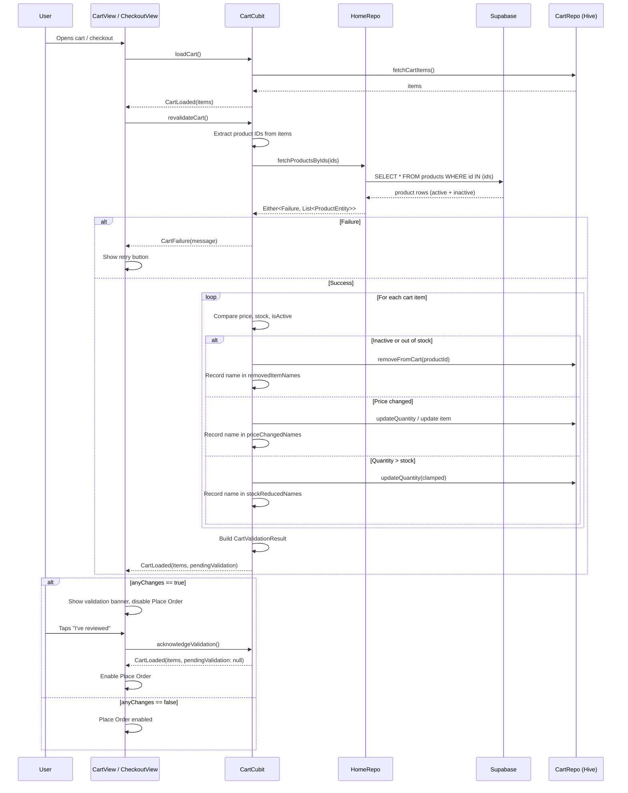
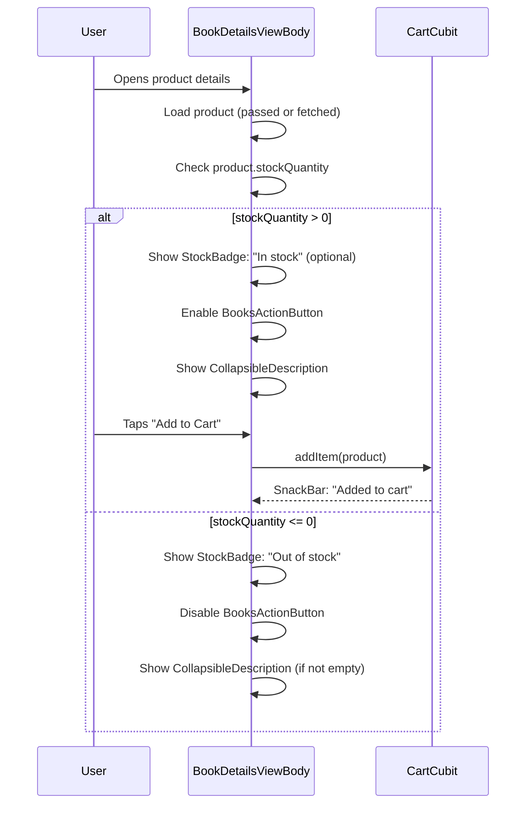
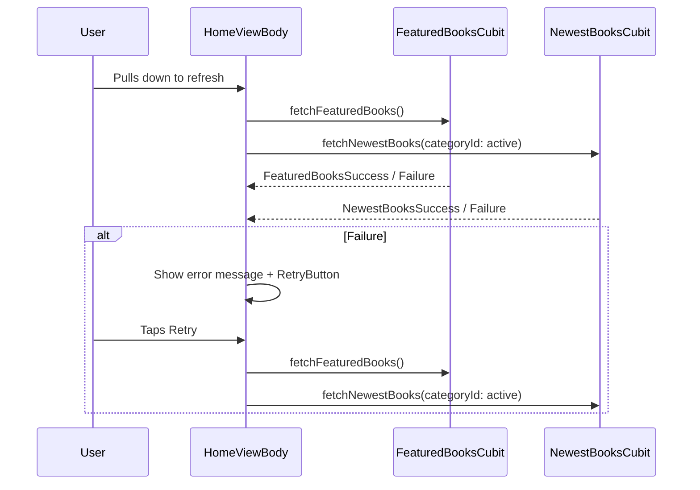

# Design Document: Stock-Aware Catalog UI

## Overview

The Halbouni Book Store user app currently has several UX gaps that prevent customers from making informed purchasing decisions: prices are displayed with a hardcoded "$" symbol and decimals instead of the correct Syrian pound (SYP) format, book descriptions are loaded but never shown, the rating widget always shows 0.0, there is no stock awareness (users can add out-of-stock items to cart with no feedback), and there is no pull-to-refresh or retry on network errors.

This feature addresses five requirements (R1-R5): an SYP currency formatter that replaces every "$" price rendering, a collapsible description section on the product details page, hiding the rating widget from all screens, stock-aware UI with cart re-validation that fetches live price/stock/availability data before checkout, and pull-to-refresh with retry buttons on catalog lists.

The approach is additive and architecture-preserving: we extend `ProductEntity` and `CartItemModel` with stock fields that the backend already exposes, add a `fetchProductsByIds` repo method using Supabase's IN-filter, create a `revalidateCart()` method on `CartCubit` that coordinates with `HomeRepo`, and build small reusable widgets (`StockBadge`, `CollapsibleDescription`) and a central currency formatter. No new state-management or DI libraries are introduced; everything uses the existing Cubit + sealed states + get_it + Either<Failure,T> pattern.

## Architecture

The feature touches all three layers (data, domain, presentation) across the Home, cart, and orders features. New utility code lives in `core/`. The diagram below shows the components and data flow, with new components in dashed boxes and modified components marked with an asterisk.

```mermaid
graph TD
    subgraph "Presentation Layer"
        HomeView["HomeViewBody*<br/>+RefreshIndicator"]
        DetailsView["BookDetailsViewBody*<br/>+description +stock badge"]
        BookItem["CustomDetailedBookItem*<br/>+stock badge -rating"]
        ActionBtn["BooksActionButton*<br/>+SYP +stock-disabled"]
        CartView["CartViewBody*<br/>+SYP +stock stepper +validation msg"]
        CheckoutView["CheckoutView*<br/>+SYP +validation gate"]
        RetryBtn["RetryButton (new)"]
        StockBadge["StockBadge (new)"]
        CollapsibleDesc["CollapsibleDescription (new)"]
    end

    subgraph "State Management (Cubits)"
        FeaturedCubit["FeaturedBooksCubit*"]
        NewestCubit["NewestBooksCubit*"]
        CartCubit["CartCubit*<br/>+revalidateCart() +acknowledge()"]
        CheckoutCubit["CheckoutCubit*<br/>+validation gate"]
    end

    subgraph "Domain Layer"
        HomeRepo["HomeRepo*<br/>+fetchProductsByIds()"]
        CartRepo["CartRepo"]
        OrdersRepo["OrdersRepo"]
    end

    subgraph "Data Layer"
        HomeRepoImpl["HomeRepoImpl*<br/>+inFilter query"]
        CartRepoImpl["CartRepoImpl<br/>(Hive box)"]
        OrdersRepoImpl["OrdersRepoImpl<br/>(place_order RPC)"]
        ProductModel["ProductModel*<br/>+stockQuantity +isActive"]
        CartItemModel["CartItemModel*<br/>+stockQuantity HiveField 6"]
    end

    subgraph "Core Utilities (new)"
        CurrencyFormatter["CurrencyFormatter<br/>formatSYP()"]
        AppStrings["AppStrings<br/>(centralized strings)"]
    end

    subgraph "Backend (Supabase)"
        ProductsTable["products table<br/>stock_quantity, is_active, description"]
        PlaceOrderRPC["place_order RPC<br/>(items, order_notes)"]
    end

    %% Data flow
    HomeView --> FeaturedCubit
    HomeView --> NewestCubit
    DetailsView --> ActionBtn
    DetailsView --> CollapsibleDesc
    DetailsView --> StockBadge
    BookItem --> StockBadge
    ActionBtn --> CartCubit
    CartView --> CartCubit
    CheckoutView --> CartCubit
    CheckoutView --> CheckoutCubit

    FeaturedCubit --> HomeRepo
    NewestCubit --> HomeRepo
    CartCubit --> HomeRepo
    CartCubit --> CartRepo
    CheckoutCubit --> OrdersRepo
    CheckoutCubit --> CartRepo

    HomeRepoImpl --> ProductsTable
    HomeRepoImpl --> HomeRepo
    CartRepoImpl --> CartRepo
    OrdersRepoImpl --> OrdersRepo
    OrdersRepoImpl --> PlaceOrderRPC

    ProductModel --> HomeRepoImpl
    CartItemModel --> CartRepoImpl

    CurrencyFormatter -.-> ActionBtn
    CurrencyFormatter -.-> CartView
    CurrencyFormatter -.-> CheckoutView
    AppStrings -.-> StockBadge
    AppStrings -.-> CollapsibleDesc
    AppStrings -.-> RetryBtn

    %% Validation flow
    CartCubit -- "fetchProductsByIds" --> HomeRepo
    HomeRepoImpl -- "SELECT * IN (ids)" --> ProductsTable
```



## Sequence Diagrams

### Cart Re-Validation Flow

This sequence shows what happens when the cart screen or checkout opens. The cart's items are re-fetched from the server, compared against the live product data, and the cart is updated with a validation result describing what changed.



### Stock-Aware Product Details Flow



### Pull-to-Refresh Flow



## Components and Interfaces

### New Components

#### 1. CurrencyFormatter (`lib/core/utils/currency_formatter.dart`)

**Purpose**: Formats prices as whole Syrian pounds with thousands separators and "SYP" suffix. Replaces every hardcoded "$" price rendering in the app.

**Interface**:
```dart
/// Formats a numeric amount as a whole-number SYP price string.
/// Example: formatSYP(1250) returns "1,250 SYP"
/// Example: formatSYP(1250.7) returns "1,251 SYP" (rounded)
/// Never contains "$" or a decimal point.
String formatSYP(num amount);
```

**Responsibilities**:
- Round the input to the nearest integer
- Insert thousands separators (comma)
- Append " SYP" suffix
- Handle zero and fractional inputs safely

#### 2. AppStrings (`lib/core/constants/app_strings.dart`)

**Purpose**: Centralizes user-facing strings introduced by this feature, supporting future localization.

**Interface**:
```dart
abstract final class AppStrings {
  // Currency
  static const String currencySuffix = 'SYP';

  // Stock
  static const String outOfStock = 'Out of stock';
  static const String inStock = 'In stock';

  // Details page
  static const String aboutThisBook = 'About this book';
  static const String description = 'Description';
  static const String readMore = 'Read more';
  static const String showLess = 'Show less';

  // Cart validation
  static const String cartChangedTitle = 'Some items in your cart have changed';
  static const String priceChanged = 'Price updated';
  static const String stockReduced = 'Quantity reduced to available stock';
  static const String itemRemoved = 'No longer available';
  static const String reviewChanges = "I've reviewed the changes";

  // Actions
  static const String addToCart = 'Add to Cart';
  static const String placeOrder = 'Place Order';
  static const String placingOrder = 'Placing order...';

  // Errors
  static const String somethingWentWrong = 'Something went wrong. Please try again.';
  static const String retry = 'Retry';
}
```

**Responsibilities**:
- Provide a single source of truth for user-facing strings
- Keep strings direction-neutral (no hardcoded left/right)
- Enable future localization by collecting strings in one class

#### 3. StockBadge (`lib/Features/Home/presentation/views/widgets/stock_badge.dart`)

**Purpose**: Displays an "Out of stock" or "In stock" badge on product cards and the details page.

**Interface**:
```dart
class StockBadge extends StatelessWidget {
  const StockBadge({super.key, required this.stockQuantity});
  final int stockQuantity;
  // Renders a small pill: red "Out of stock" when stockQuantity <= 0,
  // green "In stock" when stockQuantity > 0.
}
```

#### 4. CollapsibleDescription (`lib/Features/Home/presentation/views/widgets/collapsible_description.dart`)

**Purpose**: Displays a product description with a heading, collapsing to ~4 lines with "Read more" / "Show less" toggle.

**Interface**:
```dart
class CollapsibleDescription extends StatefulWidget {
  const CollapsibleDescription({
    super.key,
    required this.description,
    required this.heading,
  });
  final String description;
  final String heading;
  // Renders the heading, then the description text. If the text exceeds
  // 4 lines, shows "Read more" / "Show less" toggle.
  // Returns SizedBox.shrink() when description is null or empty.
}
```

#### 5. RetryButton (`lib/core/widgets/retry_button.dart`)

**Purpose**: A reusable retry button widget for error states across catalog lists.

**Interface**:
```dart
class RetryButton extends StatelessWidget {
  const RetryButton({super.key, required this.onRetry});
  final VoidCallback onRetry;
  // Renders a FilledButton with AppStrings.retry label and primaryColor background.
}
```

#### 6. CartValidationResult (`lib/Features/cart/domain/entities/cart_validation_result.dart`)

**Purpose**: Value object describing what changed during cart re-validation, used to gate the checkout Place Order button.

**Interface**:
```dart
class CartValidationResult extends Equatable {
  final List<CartItemModel> updatedItems;
  final List<String> removedItemNames;
  final List<String> priceChangedNames;
  final List<String> stockReducedNames;

  const CartValidationResult({
    required this.updatedItems,
    this.removedItemNames = const [],
    this.priceChangedNames = const [],
    this.stockReducedNames = const [],
  });

  bool get anyChanges =>
      removedItemNames.isNotEmpty ||
      priceChangedNames.isNotEmpty ||
      stockReducedNames.isNotEmpty;
}
```

### Modified Components

#### 1. ProductEntity (`lib/Features/Home/domain/entities/product_entity.dart`)

**Changes**: Add `stockQuantity` and `isActive` fields.

```dart
class ProductEntity extends Equatable {
  // ... existing fields ...
  final int stockQuantity;  // NEW
  final bool isActive;       // NEW
}
```

#### 2. ProductModel (`lib/Features/Home/data/models/product_model.dart`)

**Changes**: Parse `stock_quantity` and `is_active` from JSON. Add `stockQuantity` and `isActive` to `toJson`.

#### 3. CartItemModel (`lib/Features/cart/data/models/cart_item_model.dart`)

**Changes**: Add `@HiveField(6) final int stockQuantity` with default 0. Update `fromProductEntity`, `copyWith`, and the constructor. Hive migration is backward-compatible (old stored items use the default).

#### 4. HomeRepo (`lib/Features/Home/domain/repos/home_repo.dart`)

**Changes**: Add `fetchProductsByIds` method.

```dart
Future<Either<Failure, List<ProductEntity>>> fetchProductsByIds({
  required List<String> ids,
});
```

#### 5. HomeRepoImpl (`lib/Features/Home/data/repos/home_repo_impl.dart`)

**Changes**: Implement `fetchProductsByIds` using Supabase `.inFilter('id', ids)`. Does NOT filter by `is_active` so inactive products are returned and can be flagged during validation.

#### 6. CartCubit (`lib/Features/cart/presentation/manager/cart_cubit/cart_cubit.dart`)

**Changes**: Add `HomeRepo` dependency. Add `revalidateCart()` and `acknowledgeValidation()` methods.

#### 7. CartState (`lib/Features/cart/presentation/manager/cart_cubit/cart_state.dart`)

**Changes**: Add `pendingValidation` field to `CartLoaded` and a `needsReview` getter.

#### 8. BookDetailsViewBody (`lib/Features/Home/presentation/views/widgets/book_details_view_body.dart`)

**Changes**: Show `CollapsibleDescription`, `StockBadge`, disable `BooksActionButton` when out of stock, remove `RatingWidget` rendering, replace `Alignment.centerLeft` with `AlignmentDirectional.centerStart`.

#### 9. CustomDetailedBookItem (`lib/Features/Home/presentation/views/widgets/custom_detailed_book_item.dart`)

**Changes**: Remove `RatingWidget`, add `StockBadge`, use `formatSYP` for price.

#### 10. BooksActionButton (`lib/Features/Home/presentation/views/widgets/books_action_button.dart`)

**Changes**: Use `formatSYP` for price, disable add-to-cart when `stockQuantity <= 0`, use `EdgeInsetsDirectional` for border radius.

#### 11. HomeViewBody (`lib/Features/Home/presentation/views/widgets/home_view_body.dart`)

**Changes**: Wrap `CustomScrollView` in `RefreshIndicator`. Add `RetryButton` to error states in featured and newest book builders.

#### 12. CartViewBody (`lib/Features/cart/presentation/views/cart_view_body.dart`)

**Changes**: Use `formatSYP` for all prices. Cap quantity stepper at `min(stockQuantity, 20)`. Show validation result banner when `needsReview`. Call `revalidateCart()` on init.

#### 13. CheckoutView (`lib/Features/cart/presentation/views/checkout_view.dart`)

**Changes**: Use `formatSYP` for all prices. Call `revalidateCart()` on init. Show validation banner and disable Place Order when `needsReview`. Enable Place Order after `acknowledgeValidation()`.

## Data Models

### ProductEntity (modified)

```dart
class ProductEntity extends Equatable {
  final String id;
  final String name;
  final String? description;
  final double price;
  final String imageUrl;
  final String categoryId;
  final String categoryName;
  final bool isFeatured;
  final int stockQuantity;   // NEW — 0 means out of stock
  final bool isActive;        // NEW — false means soft-deleted
  final double? rating;       // KEPT in model, hidden from UI
  final BookDetailEntity? bookDetails;

  const ProductEntity({
    required this.id,
    required this.name,
    this.description,
    required this.price,
    required this.imageUrl,
    required this.categoryId,
    required this.categoryName,
    required this.isFeatured,
    this.stockQuantity = 0,
    this.isActive = true,
    this.rating,
    this.bookDetails,
  });

  bool get isInStock => stockQuantity > 0;

  @override
  List<Object?> get props => [
        id, name, description, price, imageUrl,
        categoryId, categoryName, isFeatured,
        stockQuantity, isActive, rating, bookDetails,
      ];
}
```

**Validation Rules**:
- `stockQuantity` is non-negative (backend default 0, nullable in DB; model defaults to 0)
- `price` is a positive number (server-side; client treats as given)
- `isActive` defaults to true when not present in JSON

### CartItemModel (modified)

```dart
@HiveType(typeId: 1)
class CartItemModel {
  @HiveField(0) final String id;
  @HiveField(1) final String name;
  @HiveField(2) final double price;
  @HiveField(3) final String imageUrl;
  @HiveField(4) final int quantity;
  @HiveField(5) final String author;
  @HiveField(6) final int stockQuantity;  // NEW — defaults to 0 for old entries

  const CartItemModel({
    required this.id,
    required this.name,
    required this.price,
    required this.imageUrl,
    required this.quantity,
    this.author = '',
    this.stockQuantity = 0,
  });

  /// Max quantity a user can add: bounded by stock and a hard cap of 20.
  int get maxQuantity => stockQuantity > 0 ? min(stockQuantity, 20) : 0;
}
```

**Validation Rules**:
- `quantity` must be >= 1 and <= `maxQuantity` (min of stockQuantity and 20)
- `stockQuantity` of 0 means the item is out of stock and should be removed
- Hive migration: adding field 6 is backward-compatible; old entries default to 0

### CartValidationResult (new)

```dart
class CartValidationResult extends Equatable {
  /// The cart items after re-validation (prices updated, quantities clamped,
  /// unavailable items removed).
  final List<CartItemModel> updatedItems;

  /// Names of items removed because they are inactive or out of stock.
  final List<String> removedItemNames;

  /// Names of items whose server-side price changed.
  final List<String> priceChangedNames;

  /// Names of items whose quantity was clamped down to available stock.
  final List<String> stockReducedNames;

  const CartValidationResult({
    required this.updatedItems,
    this.removedItemNames = const [],
    this.priceChangedNames = const [],
    this.stockReducedNames = const [],
  });

  bool get anyChanges =>
      removedItemNames.isNotEmpty ||
      priceChangedNames.isNotEmpty ||
      stockReducedNames.isNotEmpty;

  @override
  List<Object?> get props => [
        updatedItems, removedItemNames,
        priceChangedNames, stockReducedNames,
      ];
}
```

## Key Functions with Formal Specifications

### Function 1: formatSYP()

```dart
String formatSYP(num amount)
```

**Preconditions:**
- `amount` is a finite number (not NaN, not infinity)
- Expected usage: `amount` is non-negative (prices are never negative)

**Postconditions:**
- Returns a string containing the rounded integer value with thousands separators and " SYP" suffix
- The output never contains "$" or "." (decimal point)
- `formatSYP(0)` returns `"0 SYP"`
- `formatSYP(1250)` returns `"1,250 SYP"`
- `formatSYP(1250.7)` returns `"1,251 SYP"` (rounded to nearest integer)
- No side effects

**Loop Invariants:** N/A (no loops; uses regex replacement)

### Function 2: fetchProductsByIds()

```dart
Future<Either<Failure, List<ProductEntity>>> fetchProductsByIds({
  required List<String> ids,
})
```

**Preconditions:**
- `ids` is a list of UUID strings
- The Supabase client is initialized and reachable

**Postconditions:**
- Returns `Right<List<ProductEntity>>` containing all products matching the given IDs
- Does NOT filter by `is_active`; inactive products are included so callers can detect removals
- If `ids` is empty, returns `Right([])` without a network call
- On network error, returns `Left(ServerFailure(message))`
- Each returned `ProductEntity` has `stockQuantity` and `isActive` populated from the server

**Loop Invariants:** N/A

### Function 3: revalidateCart()

```dart
Future<void> revalidateCart()
```

**Preconditions:**
- CartCubit has been initialized (CartRepo and HomeRepo are injected)
- The cart may be empty, loaded, or in any state

**Postconditions:**
- If the cart is empty, no network call is made; state remains as-is
- If the network call fails, emits `CartFailure(message)` (does not lose cart items)
- For each cart item where the product is inactive or stock <= 0: item is removed from Hive and name recorded in `removedItemNames`
- For each cart item where the server price differs: item price is updated in Hive and name recorded in `priceChangedNames`
- For each cart item where quantity > stockQuantity: quantity is clamped to `min(stockQuantity, 20)` in Hive and name recorded in `stockReducedNames`
- Emits `CartLoaded(updatedItems, pendingValidation: result)`
- The `pendingValidation` field is non-null so the UI can show changes; `anyChanges` indicates whether a review is needed
- No items are silently lost; all removals are recorded in the result

**Loop Invariants:**
- For each processed item, the invariant `1 <= quantity <= min(stockQuantity, 20)` holds for all remaining items
- All previously processed items remain valid (price updated, quantity clamped) as processing continues

### Function 4: acknowledgeValidation()

```dart
void acknowledgeValidation()
```

**Preconditions:**
- `state` is `CartLoaded` with a non-null `pendingValidation`

**Postconditions:**
- Emits `CartLoaded(items, pendingValidation: null)`
- The items list is unchanged
- The checkout Place Order button becomes enabled (UI checks `needsReview` which returns false)

**Loop Invariants:** N/A

## Algorithmic Pseudocode

### SYP Formatting Algorithm

```dart
// ALGORITHM formatSYP
// INPUT:  amount of type num
// OUTPUT: formatted of type String

// BEGIN
//   ASSERT amount.isFinite
//
//   rounded <- amount.round()
//   // Handle negative values defensively (prices should never be negative)
//   IF rounded < 0 THEN
//     rounded <- 0
//   END IF
//
//   digits <- rounded.toString()
//   // Insert thousands separators using regex
//   formatted <- digits.replaceAllMapped(
//     RegExp(r'(\d)(?=(\d{3})+(?!\d))'),
//     (match) -> match[1] + ','
//   )
//
//   RETURN formatted + ' ' + AppStrings.currencySuffix
// END
```

### Cart Re-Validation Algorithm

```dart
// ALGORITHM revalidateCart
// INPUT:  none (reads current cart state and Hive box)
// OUTPUT: CartValidationResult, updated cart state

// BEGIN
//   ASSERT state is CartLoaded OR can be loaded
//
//   currentItems <- (state is CartLoaded) ? state.items : loadFromCart()
//   IF currentItems.isEmpty THEN
//     RETURN  // nothing to validate
//   END IF
//
//   ids <- currentItems.map((item) -> item.id).toList()
//   result <- await homeRepo.fetchProductsByIds(ids: ids)
//
//   result.fold(
//     (failure) -> emit(CartFailure(failure.message)),
//     (products) ->
//       productMap <- { for product in products: product.id -> product }
//
//       removedNames    <- []
//       priceChanged    <- []
//       stockReduced    <- []
//       updatedItems    <- []
//
//       FOR each item IN currentItems DO
//         ASSERT allProcessedItemsValid(updatedItems)
//
//         product <- productMap[item.id]
//
//         IF product IS NULL OR NOT product.isActive OR product.stockQuantity <= 0 THEN
//           // Item deleted, inactive, or out of stock — remove it
//           await cartRepo.removeFromCart(item.id)
//           removedNames.add(item.name)
//           CONTINUE
//         END IF
//
//         updatedItem <- item
//         changed <- false
//
//         // Check price change
//         IF product.price != item.price THEN
//           updatedItem <- updatedItem.copyWith(price: product.price)
//           priceChanged.add(item.name)
//           changed <- true
//         END IF
//
//         // Update stock quantity
//         IF product.stockQuantity != item.stockQuantity THEN
//           updatedItem <- updatedItem.copyWith(stockQuantity: product.stockQuantity)
//         END IF
//
//         // Clamp quantity to stock
//         maxQty <- min(product.stockQuantity, 20)
//         IF item.quantity > maxQty THEN
//           updatedItem <- updatedItem.copyWith(quantity: maxQty)
//           stockReduced.add(item.name)
//           changed <- true
//         END IF
//
//         IF changed THEN
//           await cartRepo.updateQuantity(item.id, updatedItem.quantity)
//           // Also persist price/stock updates
//           await cartRepo.addToCart(updatedItem)
//         END IF
//
//         updatedItems.add(updatedItem)
//       END FOR
//
//       ASSERT allUpdatedItemsHaveValidQuantity(updatedItems)
//
//       validationResult <- CartValidationResult(
//         updatedItems: updatedItems,
//         removedItemNames: removedNames,
//         priceChangedNames: priceChanged,
//         stockReducedNames: stockReduced,
//       )
//
//       emit(CartLoaded(updatedItems, pendingValidation: validationResult))
//   )
// END
```

### Stock-Aware Add to Cart Logic

```dart
// ALGORITHM canAddToCart
// INPUT:  product of type ProductEntity
// OUTPUT: canAdd of type bool

// BEGIN
//   IF NOT product.isActive THEN
//     RETURN false
//   END IF
//   IF product.stockQuantity <= 0 THEN
//     RETURN false
//   END IF
//   RETURN true
// END

// ALGORITHM maxAddQuantity
// INPUT:  product of type ProductEntity
// OUTPUT: maxQty of type int

// BEGIN
//   IF NOT canAddToCart(product) THEN
//     RETURN 0
//   END IF
//   RETURN min(product.stockQuantity, 20)
// END
```

## Example Usage

```dart
// Example 1: SYP formatting
formatSYP(0)        // "0 SYP"
formatSYP(25)       // "25 SYP"
formatSYP(1250)     // "1,250 SYP"
formatSYP(1250000)  // "1,250,000 SYP"
formatSYP(1250.7)   // "1,251 SYP" (rounded)

// Example 2: Stock-aware button
BooksActionButton(
  product: product,
  // Internally: if product.isInStock, button is enabled and shows
  // formatSYP(product.price); otherwise button shows "Out of stock" and is disabled.
)

// Example 3: Collapsible description
CollapsibleDescription(
  description: product.description ?? '',
  heading: product.bookDetails != null
      ? AppStrings.aboutThisBook
      : AppStrings.description,
)
// If description is empty or null, renders SizedBox.shrink().

// Example 4: Cart re-validation in checkout
// CheckoutView initState:
context.read<CartCubit>().revalidateCart();

// In build, check needsReview:
if (cartState is CartLoaded && cartState.needsReview) {
  // Show validation banner with changed item names
  // Disable Place Order button
  // Show "I've reviewed the changes" button
  TextButton(
    onPressed: () => context.read<CartCubit>().acknowledgeValidation(),
    child: Text(AppStrings.reviewChanges),
  )
}

// Example 5: Pull-to-refresh in HomeViewBody
RefreshIndicator(
  onRefresh: () async {
    await Future.wait([
      context.read<FeaturedBooksCubit>().fetchFeaturedBooks(),
      context.read<NewestBooksCubit>().fetchNewestBooks(
        categoryId: context.read<NewestBooksCubit>().activeCategoryId,
      ),
    ]);
  },
  child: CustomScrollView(slivers: [...]),
)
```

## Correctness Properties

### Property 1: Format round-trip preserves integer values

*For any* non-negative integer `n`, parsing `formatSYP(n)` by removing commas and the " SYP" suffix yields `n` again.

**Validates: Requirements 1.1**

### Property 2: Rounding consistency

*For any* finite `num x`, `formatSYP(x)` equals `formatSYP(x.round())`.

**Validates: Requirements 1.1**

### Property 3: No decimal points in output

*For any* finite `num x`, `formatSYP(x)` does not contain the character ".".

**Validates: Requirements 1.1**

### Property 4: No dollar sign in output

*For any* finite `num x`, `formatSYP(x)` does not contain the character "$".

**Validates: Requirements 1.1**

### Property 5: SYP suffix always present

*For any* finite `num x`, `formatSYP(x)` ends with the string " SYP".

**Validates: Requirements 1.1**

### Property 6: Thousands separators for large numbers

*For any* integer `n >= 1000`, `formatSYP(n)` contains at least one comma as a thousands separator, and the digit count (excluding commas and suffix) equals the digit count of `n`.

**Validates: Requirements 1.1**

### Property 7: Cart re-validation clamps quantities to stock

*For any* cart and set of server products, after `revalidateCart()` completes, every remaining cart item satisfies `1 <= item.quantity <= min(item.stockQuantity, 20)`.

**Validates: Requirements 4.2, 4.3**

### Property 8: Cart re-validation removes unavailable items

*For any* cart item whose corresponding product is inactive (`isActive == false`) or out of stock (`stockQuantity <= 0`) or deleted (not found in server response), `revalidateCart()` removes that item and records its name in `removedItemNames`.

**Validates: Requirements 4.3**

### Property 9: Cart re-validation updates prices

*For any* cart item whose server-side price differs from the cart price, `revalidateCart()` updates the cart item price to the server price and records the item name in `priceChangedNames`.

**Validates: Requirements 4.3**

### Property 10: Acknowledge clears review state

*For any* `CartLoaded` state with `pendingValidation != null`, calling `acknowledgeValidation()` produces a `CartLoaded` state with `pendingValidation == null` and the same items list.

**Validates: Requirements 4.4**

## Error Handling

### Error Scenario 1: Network failure during cart re-validation

**Condition**: The `fetchProductsByIds` Supabase query fails (network error, RLS denial).
**Response**: `CartCubit` emits `CartFailure(message)`. The cart items from the previous `CartLoaded` state are preserved in Hive. The UI shows a retry button.
**Recovery**: User taps Retry; `revalidateCart()` is called again. If it succeeds, the cart is updated normally.

### Error Scenario 2: Product deleted between add-to-cart and checkout

**Condition**: A product that was added to the cart has been deleted from the server (no row returned).
**Response**: `revalidateCart()` removes the item from Hive, records the item name in `removedItemNames`, and the UI shows "No longer available" next to the removed item name.
**Recovery**: The user reviews the changes and acknowledges; Place Order is enabled for the remaining items.

### Error Scenario 3: Product price changed since add-to-cart

**Condition**: The server-side price differs from the cart snapshot.
**Response**: `revalidateCart()` updates the cart item price, records the name in `priceChangedNames`, and the UI shows the old vs new price or a "Price updated" message.
**Recovery**: The user reviews and acknowledges; Place Order proceeds with the updated price.

### Error Scenario 4: Stock reduced below cart quantity

**Condition**: The server reports `stockQuantity` lower than the cart item `quantity`.
**Response**: `revalidateCart()` clamps the quantity to `min(stockQuantity, 20)`, records the name in `stockReducedNames`, and the UI shows "Quantity reduced to available stock".
**Recovery**: The user reviews and acknowledges; Place Order proceeds with the clamped quantity.

### Error Scenario 5: Product inactive (soft-deleted)

**Condition**: The server reports `isActive == false` for a cart item.
**Response**: `revalidateCart()` removes the item, records the name in `removedItemNames`, and the UI shows "No longer available".
**Recovery**: Same as deleted product.

### Error Scenario 6: Catalog fetch failure (home screen)

**Condition**: Featured or newest books fetch fails.
**Response**: The cubit emits a failure state. The UI shows a friendly error message and a Retry button (no raw exception text).
**Recovery**: User taps Retry or pulls down to refresh; the cubit re-fetches.

### Error Scenario 7: Empty cart at checkout

**Condition**: The user navigates to checkout with an empty cart (e.g., all items were removed by validation).
**Response**: The checkout view shows "Your cart is empty" with a "Browse books" button that navigates home.
**Recovery**: User navigates home and adds items.

## Testing Strategy

### Unit Testing Approach

Unit tests cover pure functions and value objects:
- `formatSYP()` with edge cases: 0, 25, 1250, 1250000, negative (clamped to 0), fractional (rounded), very large numbers
- `CartValidationResult.anyChanges` logic
- `ProductEntity.isInStock` getter
- `CartItemModel.maxQuantity` getter (respects stock cap and hard cap of 20)
- `ProductModel.fromJson` parsing `stock_quantity` and `is_active` (including missing fields and defaults)

### Property-Based Testing Approach

Property-based tests validate the SYP formatter across a wide input space:
- Generate random non-negative integers and verify round-trip (Property 1)
- Generate random doubles and verify rounding consistency (Property 2)
- Verify no decimal points or dollar signs for any input (Properties 3-4)
- Verify SYP suffix present for any input (Property 5)
- Verify thousands separators for n >= 1000 (Property 6)

**Property Test Library**: `property_based_testing` or `flutter_test` with custom generators (the project uses `flutter_test`; we can use `dart:math.Random` for simple generators or add `fast_check` if available).

### Cubit Testing Approach (bloc_test + mocktail)

The cart re-validation cubit is tested with `bloc_test` and `mocktail` for mocked `HomeRepo` and `CartRepo`:

**Test cases** (per Requirements 4.5):
1. **Price changed**: Mock returns same product but with a different price. Expect `CartLoaded` with updated price and `priceChangedNames` containing the item name. `anyChanges == true`.
2. **Stock reduced**: Mock returns product with stock < cart quantity. Expect quantity clamped and `stockReducedNames` populated. `anyChanges == true`.
3. **Item inactive**: Mock returns product with `isActive == false`. Expect item removed and `removedItemNames` populated. `anyChanges == true`.
4. **Item out of stock**: Mock returns product with `stockQuantity == 0`. Expect item removed and `removedItemNames` populated. `anyChanges == true`.
5. **Nothing changed**: Mock returns identical products. Expect `anyChanges == false` and `pendingValidation != null` (validation was performed, no changes found).
6. **Item deleted**: Mock returns no matching product. Expect item removed and `removedItemNames` populated.
7. **Network failure**: Mock throws. Expect `CartFailure` emitted.
8. **Empty cart**: No items. Expect no network call, no state change.
9. **acknowledgeValidation()**: From `CartLoaded(pendingValidation: result)` where `anyChanges == true`, expect `CartLoaded(pendingValidation: null)`.

**Mock setup**:
```dart
// Example test skeleton:
class MockHomeRepo extends Mock implements HomeRepo {}
class MockCartRepo extends Mock implements CartRepo {}

void main() {
  late MockHomeRepo mockHomeRepo;
  late MockCartRepo mockCartRepo;
  late CartCubit cartCubit;

  setUp(() {
    mockHomeRepo = MockHomeRepo();
    mockCartRepo = MockCartRepo();
    cartCubit = CartCubit(mockCartRepo, mockHomeRepo);
  });

  blocTest<CartCubit, CartState>(
    'emits CartLoaded with priceChangedNames when server price differs',
    build: () {
      when(() => mockCartRepo.fetchCartItems()).thenAnswer(
        (_) async => right([CartItemModel(id: 'p1', name: 'Book A', ...)]),
      );
      when(() => mockHomeRepo.fetchProductsByIds(ids: ['p1']))
          .thenAnswer((_) async => right([
            ProductModel(id: 'p1', name: 'Book A', price: 30.0, ...),
            // price changed from 25.0 to 30.0
          ]));
      when(() => mockCartRepo.addToCart(any())).thenAnswer((_) async => right(null));
      return cartCubit;
    },
    act: (cubit) async {
      await cubit.loadCart();
      await cubit.revalidateCart();
    },
    expect: () => [
      isA<CartLoading>(),
      isA<CartLoaded>(),
      isA<CartLoaded>().having(
        (s) => s.pendingValidation?.priceChangedNames,
        'priceChangedNames',
        ['Book A'],
      ),
    ],
  );
}
```

### Widget Testing Approach

Widget tests cover the new UI components:
- `CollapsibleDescription`: short text (no toggle), long text (toggle visible, expands/collapses), empty text (renders nothing)
- `StockBadge`: stockQuantity > 0 (shows "In stock"), stockQuantity <= 0 (shows "Out of stock")
- `BooksActionButton`: in-stock product (enabled, shows SYP price), out-of-stock product (disabled)
- `CartViewBody`: SYP formatting in summary, quantity stepper respects maxQuantity
- `CheckoutView`: validation banner visible when needsReview, Place Order disabled until acknowledged

### Integration Testing Approach

Integration tests verify end-to-end flows:
- Cart re-validation: add items, mock server response with changes, verify cart updated and validation banner shown
- Pull-to-refresh: pull down on home, verify featured and newest cubits re-fetch
- Retry button: trigger error state, tap retry, verify re-fetch

## Performance Considerations

- **Single query for cart validation**: `fetchProductsByIds` uses a single Supabase `.inFilter()` query rather than N queries per cart item, keeping network cost at O(1) round-trips.
- **Slim product select**: The validation query selects `*, categories(name), book_details(*)` like existing queries. If performance becomes a concern, the select can be narrowed to `id, name, price, stock_quantity, is_active` for the validation path.
- **Hive field addition**: Adding `@HiveField(6)` is a backward-compatible schema migration; old cart items use the default value 0, no data migration step needed.
- **RefreshIndicator**: Pull-to-refresh triggers both featured and newest cubits in parallel via `Future.wait`, avoiding sequential waterfall.
- **Quantity cap**: The hard cap of 20 per line item prevents excessive quantities from being sent to the server, reducing payload size and protecting against the current `place_order` which doesn't enforce a limit.

## Security Considerations

- **No client-side trust**: The cart re-validation is a UX feature, not a security boundary. The server-side `place_order` RPC remains the authoritative source for order creation. Client-side price updates are for display only; the server computes totals from its own product table.
- **No secrets exposed**: The Supabase anon key is already public and publishable. No new credentials are introduced.
- **RLS unchanged**: The validation query reads from the public-readable `products` table (same RLS policy as all existing queries). No new RLS or RPC changes are required.
- **Input sanitization**: The `fetchProductsByIds` query uses Supabase's parameterized `.inFilter()` method, which escapes values automatically. No raw SQL injection risk.
- **No schema changes**: This feature does not modify any Supabase tables, functions, or RLS policies. It only reads existing `stock_quantity`, `is_active`, and `description` columns that are already exposed.

## Dependencies

### Existing dependencies (no new packages required)
- `flutter_bloc` / `bloc` — Cubit + sealed states (already in use)
- `dartz` — Either<Failure, T> (already in use)
- `equatable` — value equality for entities (already in use)
- `hive` / `hive_flutter` — offline cart storage (already in use)
- `supabase_flutter` — backend queries and RPC (already in use)
- `cached_network_image` — product image loading (already in use)
- `go_router` — navigation (already in use)

### Dev/test dependencies (already allowed per PROJECT_CONTEXT.md)
- `bloc_test` — for cubit testing with mock states (allowed)
- `mocktail` — for mocking repos in cubit tests (allowed)
- `flutter_test` — for widget and unit tests (already in use)

### No new production dependencies
This feature requires no new production packages. All functionality is built with the existing stack.

### Backend dependencies (none required)
The feature reads existing `products` table columns (`stock_quantity`, `is_active`, `description`) that are already in the live schema. No migrations, no new RPC functions, no RLS changes are needed.

## Schema Requests

No schema requests are needed for this feature. All required columns (`stock_quantity`, `is_active`, `description`) already exist in the live `products` table and are publicly readable via the existing RLS policy. The current `place_order(items jsonb, order_notes text)` RPC signature is used as-is; no C1 contract changes are invoked.
